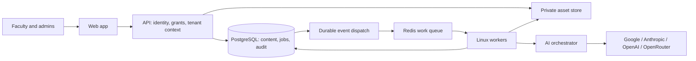

# System Architecture

Consolidated 18 October 2026. **Agreed:** modular monolith with background workers and tenant isolation. **Proposed:** concrete stack, service composition and runtime mechanics below; see P-01–P-35.

## Boundaries

Web and API share a common entry point. Normal faculty context is derived from one active coaching membership; platform routes require explicit source/target coaching context and full platform authorization. A tenant ID in a browser payload is never authority.

Modules: identity/access, coaching administration/branding, content/revisions/QC, sources/assets, ingestion/patterns, taxonomy/graph, duplicate relationships, AI/catalogue/budgets, notifications/audit and dataset copy. Later tests/learning reuse stable IDs but do not enter the current scope.

## Storage and persistence

PostgreSQL is proposed as the source of truth for content, revision-bound workflow evidence, durable jobs and cost reservations. Relational foreign keys enforce coaching ownership; JSONB contains versioned typed rich content and snapshots. Runtime roles are not superusers/table owners/BYPASSRLS; use deny-by-default RLS with a server-established transaction context. Platform operations use explicit scoped service paths, not a browser-controlled bypass flag.

Private original/assets storage is behind an interface: local persistent filesystem initially, S3-compatible backend later if selected. Users never receive arbitrary filesystem paths. Immutable asset IDs/checksums, ownership references and retention dependencies protect published questions and independent destination copies.

Redis is proposed for broker/cache, not the only durable record of work. Database event/outbox records dispatch queue tasks and app notifications retry-safely. There is no notification-email outbox.

## Request and worker flow

Authenticate → resolve current role/membership → authorize action → establish trusted tenant transaction context → validate revisions/references → persist domain change + audit/event → commit → asynchronous dispatch.

Workers receive identifiers rather than trusting queued payload content. Re-resolve tenant, current actor authority, input revision, cancellation state and budget before provider dispatch or protected writes. A late AI answer cannot overwrite a changed revision or write after authority is revoked.

CPU-heavy parsing/OCR runs outside API request handlers. Work state/progress persists across navigation and restarts; jobs retain partial drafts with warnings and source anchors. Candidate/duplicate resolution precedes final new-question materialization.

## Content and AI

Append-only revisions hold rich blocks, typed answers, metadata snapshots and exact passage/asset dependencies. Human QC/approval binds revision hashes. Edits invalidate current eligibility; published snapshots never mutate.

Provider adapters implement one project-owned operation contract. Google/Anthropic/OpenAI/OpenRouter are first-release providers; compatible capabilities differ by model/endpoint. Keep selection, actual route/model, attempt/failure, input/output/schema/prompt versions and usage evidence. Coaching keys only; no shared-key rescue. Model output is untrusted content, not permissions or executable pattern code.

Pattern reuse reads fresh source content, validates coverage and falls back on uncertain regions. Same-coaching duplicate retrieval remains bounded at lakh-scale. Complete coaching copy uses a consistent manifest, independent mapped ownership and resumable idempotent operations.

## Local environment and later hosting

Development target is this Windows PC. Proposed Linux containers/WSL2 isolate API/worker/runtime dependencies; Celery's official documentation does not support native Windows execution. Do not install or start services as part of documentation. See [local plan](LOCAL_DEVELOPMENT_PLAN.md).

Production topology, domain, hosted budget and availability/recovery targets are deferred. Later migration should change deployment/configuration, not rewrite tenant/content ownership. Architecture alone proves no performance, quality, security or operational guarantee.

## References

[Official sources and verification boundaries](TECHNICAL_REFERENCES.md); [database](DATABASE_SCHEMA.md); [API](API_CONTRACTS_DRAFT.md); [security](SECURITY_AND_MULTI_TENANCY.md).
